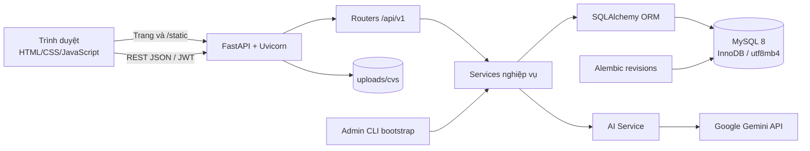
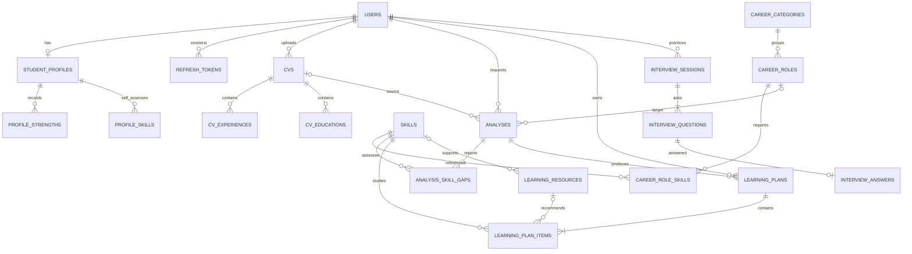

# Thiết kế hệ thống — Career Mentor MVP

**Phiên bản:** 1.0 · **Cơ sở đối chiếu:** `master` (`473df9a`)

## 1. Kiến trúc tổng thể

### Thành phần và trách nhiệm

- `app/main.py`: tạo FastAPI app, exception handlers, CORS, đăng ký routers, static files, UI routes và `/health`.
- `app/routers/`: HTTP contract, authentication dependencies và gọi services.
- `app/services/`: nghiệp vụ Auth, Profile, CV, Analysis, Interview, Learning Plan, Catalog/Admin và Dashboard.
- `app/models/`, `app/schemas/`: mapping SQLAlchemy, quan hệ dữ liệu và DTO/Pydantic validation.
- `app/services/ai/`: provider Gemini dùng chung; AI được gọi ở tầng service, không nhúng SDK vào router.
- `app/static/`: HTML, CSS và JavaScript thuần cho khám phá, hồ sơ, CV, phân tích, lộ trình, phỏng vấn, dashboard và Admin.
- `alembic/`: lịch sử schema; revision head hợp nhất hiện tại là `f7a8b9c0d1e2`.
- `Dockerfile`, `docker-compose.yml`, `docker-entrypoint.sh`, `deploy/nginx.conf`: đóng gói API, MySQL và Nginx TLS cho staging. Compose gồm `db`, `api`, `nginx`; dữ liệu DB và CV dùng volumes.

## 2. Mô hình dữ liệu

| Nhóm bảng | Bảng | Mục đích |
|---|---|---|
| Tài khoản | `users`, `refresh_tokens` | Vai trò/trạng thái người dùng; phiên refresh token hash, family và thu hồi. |
| Hồ sơ | `student_profiles`, `profile_strengths`, `profile_skills` | Thông tin sinh viên, điểm mạnh và tự đánh giá. |
| Nghề/kỹ năng | `career_categories`, `career_roles`, `skills`, `career_role_skills` | Catalog nghề, mức độ và trọng số kỹ năng cần thiết. |
| CV | `cvs`, `cv_experiences`, `cv_educations` | Metadata/tệp và dữ liệu trích xuất; tệp lưu dưới `uploads/cvs`. |
| Phân tích | `analyses`, `analysis_skill_gaps` | Trạng thái tác vụ, consent, readiness, summary, bằng chứng và khuyến nghị skill gap. |
| Học tập | `learning_resources`, `learning_plans`, `learning_plan_items` | Tài nguyên có trạng thái duyệt; lộ trình và nhiệm vụ theo tuần. |
| Phỏng vấn | `interview_sessions`, `interview_questions`, `interview_answers` | Vòng đời phiên, ba câu hỏi và câu trả lời kèm điểm/feedback. |

Quy tắc xóa và ràng buộc được định nghĩa bằng foreign keys/check constraints trong models và migrations; ví dụ xóa người dùng cascade dữ liệu sở hữu, xóa CV có thể giữ báo cáo phân tích với `cv_id` rỗng, còn kỹ năng được tham chiếu bị hạn chế xóa vật lý.

## 3. API endpoints chính

Các API dùng prefix `/api/v1`; endpoint đầy đủ/schema được công bố ở `/docs`.

| Phân hệ | Endpoint chính |
|---|---|
| Health | `GET /health` |
| Auth | `POST /auth/register`, `/login`, `/refresh`, `/logout`; `GET /auth/me` |
| Hồ sơ | `GET`, `PUT /profile/me` |
| CV | `POST`, `GET /cvs`; `GET`, `DELETE /cvs/{cv_id}` |
| Catalog công khai | `GET /catalog/categories`, `/roles`, `/roles/{role_id}`, `/roles/{role_id}/skills`, `/skills`, `/resources`; danh mục chi tiết/tra cứu theo tham số ở OpenAPI |
| Career | `GET /careers`, `/careers/{career_id}`, `/careers/{career_id}/skills` |
| Phân tích | `POST /analyses` (202, xử lý nền); `GET /analyses` (history), `/{analysis_id}/status`, `/{analysis_id}`, `/{analysis_id}/skills` |
| Lộ trình | `POST`, `GET /learning-plans`; `GET /learning-plans/{plan_id}`; `PATCH /{plan_id}/status`, `/items/{item_id}` |
| Phỏng vấn | `POST`, `GET /interviews`; `GET /{session_id}`, `/{session_id}/questions`; `POST /{session_id}/answers`, `/{session_id}/complete` |
| Dashboard | `GET /dashboard/summary`, `/skill-radar`, `/readiness-history`, `/learning-progress`, `/interview-history` |
| Admin | `/admin/stats`, `/admin/users`, `/admin/users/{user_id}`, `/admin/users/{user_id}/status`; CRUD/enable-disable `/admin/career-categories`, `/career-roles`, `/skills`, `/resources`; `/resources/{item_id}/approval` |

Những route Admin trên thuộc `/api/v1/admin`; toàn router có dependency `require_admin`. Phương thức HTTP chi tiết: nhóm danh mục hỗ trợ GET/POST/PUT/DELETE theo resource; career roles, skills và resources có PATCH trạng thái; resources có PATCH approval.

## 4. Luồng xử lý quan trọng

### 4.1 Đăng nhập và phân quyền

1. Auth service xác minh mật khẩu, trạng thái tài khoản và cấp access JWT + refresh token.
2. Refresh token được lưu dạng SHA-256; refresh hợp lệ xoay vòng token. Phát hiện reuse xử lý theo session family.
3. Dependency lấy user từ token và đối chiếu vai trò/trạng thái trong DB. Admin router yêu cầu Admin ở backend.

### 4.2 CV → phân tích skill gap

1. CV endpoint xác thực tệp và quyền sở hữu, lưu PDF, trích văn bản bằng PyMuPDF.
2. POST `/analyses` yêu cầu AI consent được hỗ trợ, vị trí còn hoạt động/có kỹ năng bắt buộc và nguồn CV/hồ sơ có dữ liệu.
3. Tạo `Analysis(status=pending)`, trả `202 Accepted` và lên background task.
4. Service gọi AI có cấu trúc, lưu điểm kỹ năng/bằng chứng/khuyến nghị, readiness và trạng thái `completed` hoặc `failed`.
5. Client polling status rồi xem report và skill gaps; dữ liệu được lọc theo user hiện tại.

### 4.3 Lộ trình học

Tạo lộ trình từ analysis của chính user; service chọn/tổ chức tài nguyên học tập đã được duyệt phù hợp skill gap, lưu plan và các item theo tuần. API PATCH ghi trạng thái plan hoặc completion timestamp của item; Dashboard đọc lại tiến độ.

### 4.4 Phỏng vấn thử

Tạo phiên với role và consent → sinh/lưu ba câu hỏi → nhận câu trả lời và chấm AI → lưu điểm/feedback → hoàn thành khi trả lời đủ, tính điểm trung bình. Session cũ được xử lý trạng thái abandoned theo logic service/migration.

### 4.5 Quản trị catalog

Admin CRUD danh mục/role/skill/resource. Resource status (`pending`, `approved`, `rejected`) và active flag độc lập; public catalog chỉ công khai resource được duyệt và đang hoạt động. Xóa một số danh mục dùng soft-disable để không phá liên kết dữ liệu lịch sử.

## 5. Migrations, cấu hình và vận hành

- Có 25 revision Alembic, bao gồm tạo schema, seed catalog, phân quyền, refresh sessions, lộ trình/phỏng vấn, AI report metadata và các migration hợp nhất/sửa tương thích schema cũ.
- Kiểm tra hiện tại `python -m alembic heads` trả về duy nhất `f7a8b9c0d1e2`. Chưa xác nhận `upgrade head` trên MySQL thật nếu DB không truy cập được.
- `DATABASE_URL` bắt buộc; MySQL dùng PyMySQL và `utf8mb4`. `SECRET_KEY` production phải là giá trị ngẫu nhiên bí mật; `CORS_ALLOWED_ORIGINS` chỉ nhận origin cụ thể.
- `GEMINI_API_KEY` không bắt buộc để khởi động nhưng bắt buộc cho gọi Gemini thật.
- Lệnh chạy dev: `python -m uvicorn app.main:app --reload`; lệnh migrate: `python -m alembic upgrade head`.
- Health endpoint là `/health`; OpenAPI tại `/openapi.json`; Swagger UI tại `/docs`.
